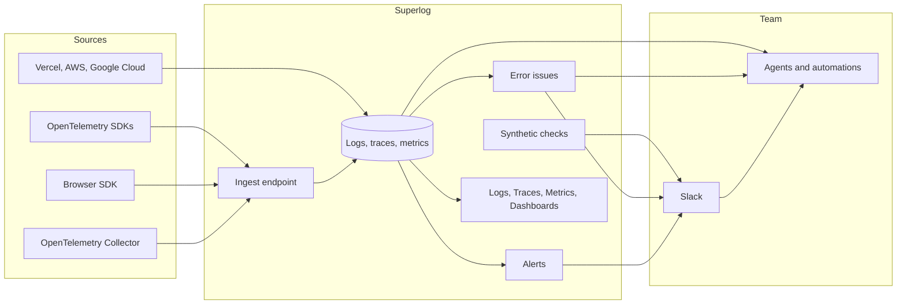

import EarlyAccess from "/snippets/early-access.mdx";

<EarlyAccess />

Your apps send logs, traces, and metrics to Superlog. Superlog stores them, groups exceptions into error issues, checks alerts and synthetic checks on a schedule, and posts to Slack when something is wrong. Agents read the same data through the MCP server and automations.

## 1. Your apps send telemetry

Backend services send OpenTelemetry over OTLP/HTTP to your region's ingest endpoint with an ingest key. Browser apps send with the Superlog browser SDK. A Collector you already run can forward to the same endpoint. Vercel, AWS CloudWatch, and Google Cloud connect without code changes.

The ingest key decides which workspace the data goes to. It can only add data. See [Collect telemetry](/collect-telemetry/overview).

## 2. Superlog stores it by service

Every record keeps its resource attributes. `service.name` and `deployment.environment.name` are the ones Superlog groups and filters by. Each log record can carry the trace and span IDs of the request that wrote it, so you can go from a log line to its trace.

When each service passes W3C trace context to the next, one user action becomes one trace, from the browser to every backend service and queue it reaches.

## 3. You explore it

- [Logs](/telemetry/logs): search and filter log records.
- [Traces](/telemetry/traces): find slow or failing requests and open a trace to see every span.
- [Metrics](/telemetry/metrics): chart any metric your services send.
- [Dashboards](/telemetry/dashboards): put the charts your team watches on one shared page.

## 4. Superlog detects problems

| Feature | Reads | Tells you when |
|---|---|---|
| [Errors](/telemetry/errors) | Exception span events and error logs | A new error appears, or a resolved one comes back |
| [Alerts](/telemetry/alerts) | A log count, span measure, or metric | The value crosses a threshold, and when it recovers |
| [Synthetic checks](/telemetry/synthetics) | Requests Superlog sends to your URLs | An endpoint fails or is too slow, and when it passes again |

Errors work without setup: exceptions are grouped into issues as they arrive. Alerts and synthetic checks are rules you create.

## 5. Your team hears about it in Slack

Error notifications, alerts, and synthetic checks post to the Slack channels you choose. Recoveries reply in the same thread. You can resolve or silence an error from its Slack message.

## 6. Agents investigate

- **MCP server.** Claude Code, Cursor, Codex, and other agents query your logs, traces, and metrics, read error issues, and create dashboards, alerts, and checks. See [Install Superlog MCP](/assistants/claude).
- **Automations.** An automation can start on a new or regressed error, or on an alert or check message in a Slack channel it watches. It runs a coding agent with your repositories, finds the cause, and can open a pull request. See [Automations](/automations/overview).

## Where to start

<CardGroup cols={2}>
  <Card title="Instrument your app" icon="satellite-dish" href="/guides/instrument-your-app">
    Create an ingest key and send your first data.
  </Card>
  <Card title="Make your application reliable" icon="shield-check" href="/reliability/checklist">
    Set up dashboards, alerts, and notifications with one prompt.
  </Card>
</CardGroup>
